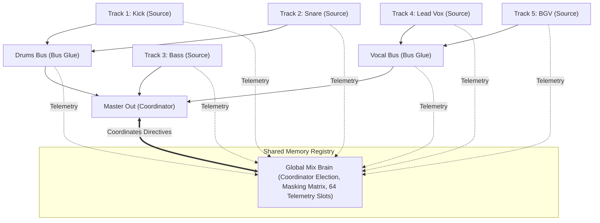

# AI Mixer v1.0.0

A real-time, zero-latency, multi-instance autonomous mixing plugin built with C++20 and JUCE 8.

---

## 1. Concept & Vision

Inspired by conversations on the **Churchfront** podcast with Front-of-House (FOH) engineer **Tyler Kerpsack**, **AI Mixer** reimagines the live and broadcast audio mixing workflow:

> *"Instead of spending hours dialing individual high-pass filters, setting sidechains, carving overlapping frequency notches, and riding faders, the engineer acts as an executive producer or curator (like Rick Rubin) — dictating sonic taste, aesthetic balance, and energy, while an intelligent, unified engine handles the underlying corrective and acoustic coordination in real time."*

### Key Tenets
- **100% Local & Zero Runtime Internet**: Runs entirely on the local machine with no cloud dependencies, no accounts, and no data telemetry leaves your computer.
- **Zero-Latency Audio DSP**: Source and Bus roles operate with **0 samples of added latency**, making the engine suitable for live in-ear monitors (IEMs) and FOH sound reinforcement.
- **Unified Inter-Instance Communication**: A single plugin binary is placed on every track, bus, and master. Instances discover each other via a high-performance memory-mapped shared memory registry using lockless atomic seqlocks.
- **Adaptive Mix Brain**: A designated Coordinator instance continuously evaluates global spectral masking, dynamic ducking relationships (e.g. Kick vs. Bass), vocal presence carving, and speech bed leveling at 10–15 Hz.

---

## 2. Roles & Architecture

One binary fulfills all three roles in the session:



### The Three Roles
1. **SOURCE (Instrument / Vocal Track)**:
   - Analyzes incoming audio with a 32-band spectrum analyzer and feature classifier.
   - Runs the **Universal Safe Chain**: automatic trim to -18 dBFS RMS (capped at $\pm12\text{ dB}$), instrument-specific HPF/LPF, and transparent leveling compression.
   - Runs the **Playbook Stage**: instrument-tailored gate/expander, character EQ, de-esser, zero-latency warmth saturation, transient shaping, local phrase rider, and stereophonic width with sub-120 Hz mono-summing.
2. **BUS (Subgroup Processing)**:
   - Provides bus-specific VCA glue compression (Drums, Vocals, Guitars, Keys, Acoustic, Master) with dry/wet parallel blend.
   - Can optionally act as a dedicated **FX Return Host**.
3. **MASTER / COORDINATOR (Master Stereo Out)**:
   - Runs the central **Global Mix Brain**: solves spectral collisions, calculates dynamic ducking depths, applies genre profile rules, and broadcasts directives.
   - Master Chain: BS.1770-5 loudness measurement, destination auto-gain, 3-band tonal balance EQ, and 4x oversampled true-peak lookahead limiter.
   - **Fault-Tolerant Election**: If no Master instance is placed, the oldest registered Source instance elects itself Coordinator so the mix engine remains fully functional.

---

## 3. Routing Truth & Shared FX Architecture

AI Mixer supports two distinct workflows for reverberation and delay:

### Workflow A: Local Tails Mode (Default)
In Local Tails mode, each Source instance generates its own reverb and delay tails internally based on the global taste profile.
- **Benefit**: Zero DAW auxiliary routing required. Drops right onto tracks without setting up send/return buses.
- **CPU Optimization**: Inactive engines automatically enter low-power sleep mode via hangover counters when the source signal is silent.

### Workflow B: Dedicated DAW Return Host
For engineers who prefer conventional DAW auxiliary sends:
- Set an auxiliary track's AI Mixer instance to role **`Bus`** and select **`FX`** bus type.
- This mutes direct dry audio and operates 100% wet with true impulse isolation (zero predelay dry bleed).
> [!WARNING]
> **Double-Reverb Hazard**: If you send tracks to a DAW Return Host, disable **Local Tail** on individual Source instances to prevent double-processing reverb on the same instrument!

### Special Signal Handling
- **Click Track Pass-Through**: Tracks identified as `Click` completely bypass all dynamics, EQ, saturation, and FX. Output is **bit-exact bit-transparent pass-through** ($L_{\infty} = 0.000000$), preserving click fidelity and timing.
- **Pastor Speech Bed**: When a `PastorSpeaking` source is detected, the solver automatically ducks background pads, synths, and acoustic guitars by **-4 dB** to maintain speech intelligibility.

---

## 4. Destination Loudness Targets

The Master role features target-based loudness regulation according to ITU-R BS.1770-5 and EBU R128:

| Destination Target | Integrated Target | True Peak Ceiling | Release Time | Primary Use Case |
| :--- | :---: | :---: | :---: | :--- |
| **Live PA** | -18.0 LUFS | -1.0 dBTP | 100 ms | Front-of-House auditorium reinforcement with wide dynamic headroom. |
| **Broadcast** | -14.0 LUFS | -1.0 dBTP | 150 ms | Live stream delivery (YouTube, Facebook Live, church online). |
| **Streaming** | -14.0 LUFS | -1.0 dBTP | 200 ms | Spotify, Apple Music, and streaming content standards. |
| **Club / Loud** | -11.0 LUFS | -0.5 dBTP | 80 ms | High-energy contemporary music with dense competitive loudness. |

---

## 5. Genre Taste Profiles & Macros

The mix engine comes pre-calibrated with four golden profiles:

1. **Modern Worship (Default)**:
   - Reverb: Large Hall, 3.2s decay, 20ms predelay, 0.50 damping.
   - Delay: Dotted-Eighth (375ms @ 120 BPM), feedback 0.35, Ping-Pong ON.
   - Balanced vocal-forward presentation with controlled low-end dynamics.
2. **Acoustic Worship**:
   - Reverb: Warm Room, 1.6s decay, 10ms predelay, 0.60 damping.
   - Delay: Eighth note, feedback 0.25, Ping-Pong OFF.
   - Acoustic guitar emphasis (+2 dB), drum/percussion reduction (-2 dB), organic warmth.
3. **Gospel**:
   - Reverb: Plate, 2.4s decay, 15ms predelay, 0.40 damping.
   - Delay: Dotted-Eighth, feedback 0.40, Ping-Pong ON.
   - Rich harmonic saturation (warmth 1.4x), piano/keys lift (+2 dB), BGV group presence (+2 dB).
4. **Rock / Pop**:
   - Reverb: Snappy Plate, 1.8s decay, 8ms predelay, 0.35 damping.
   - Delay: Quarter note, feedback 0.30, Ping-Pong OFF.
   - Aggressive transient punch (1.4x), driving electric guitars (+2 dB), punchy kick and snare (+1 dB).

### Continuous Taste Macros
- **Vocal Forward** ($\pm3\text{ dB}$ vocal balance)
- **Energy** (dynamics compression ratio & transient impact)
- **Warm / Bright** ($\pm1.5\text{ dB}$ tilt shelf @ 8 kHz)
- **Space** ($\pm6\text{ dB}$ shared reverb/delay send scalar)
- **Saturation** (0.0x to 2.0x analog warmth drive)

---

## 6. Known Limitations & Operational Notes

- **Master Chain Latency (52 samples)**:
  - Source and Bus instances run with strictly **0 samples of added latency**.
  - The Master chain utilizes a 4x oversampled true-peak lookahead limiter, adding **52 samples of latency** ($\approx 1.08\text{ ms}$ @ 48 kHz).
  - Certain DAWs require stopping and restarting audio playback when toggling a plugin to or from the Master role to re-align host delay compensation (PDC).
- **Instance Capacity**:
  - The memory-mapped shared memory registry accommodates up to **64 concurrent instances** per session.
- **Local IPC Scope**:
  - The shared memory architecture coordinates all instances residing on the same host operating system. To link multiple computers, route audio over Dante or Ravenna into a single mixing host.

---

## 7. Verification & Test Suite

The project includes an exhaustive verification suite (`AIMixerTests.exe`) verifying all system contracts:

```
[TEST 1] TrackNameParser: 89 test cases including regex edge cases & traps
[TEST 2] Identity Precedence: User > TrackName > Classifier > Unknown
[TEST 3] Synthetic Classifier: Signal onset, centroid, decay, fundamental detection
[TEST 4] Auto-Trim: Convergence from -30 dBFS & -6 dBFS to -18 dBFS RMS within +/-12 dB
[TEST 5] Safe Chain HPF/LPF: Exact cutoff matching & filter bypass
[TEST 6] Strict Zero Latency: 0 samples on Source & Bus
[TEST 7] Click Track: 100% bit-exact pass-through verified
[TEST 8] Coordinator Election: Earliest survivor election & protocol version guard
[TEST 9] Solver Dynamics: Kick/Bass ducking, vocal masking, 1500-cycle convergence
[TEST 10] Playbooks: Character EQ, de-esser, saturation, transient shaper, stereo width
[TEST 11] Bus Glue: Drums, Vocals, Guitars, Master bus compressors
[TEST 12] Master Chain: BS.1770-5 loudness, auto-gain convergence, true peak ceiling
[TEST 13] Taste Layer: 4 golden profiles, 5 macros, session modes, JSON round-trip
[HARDENING 1] FX Return Host Wet-Only: 0 bleed during predelay, pure wet tail
[HARDENING 2] Two-Source Shared Character: Bit-exact matching RT60 for Hall & Room
[HARDENING 3] Taste Broadcast Latency: < 1000 ms lockless IPC update
[HARDENING 4] Master Latency: Exactly 52 samples (+/-2), Source/Bus = 0
[HARDENING 5] CPU Benchmarks: Single Source with FX < 1.2%, 16-instance session < 20%
```
